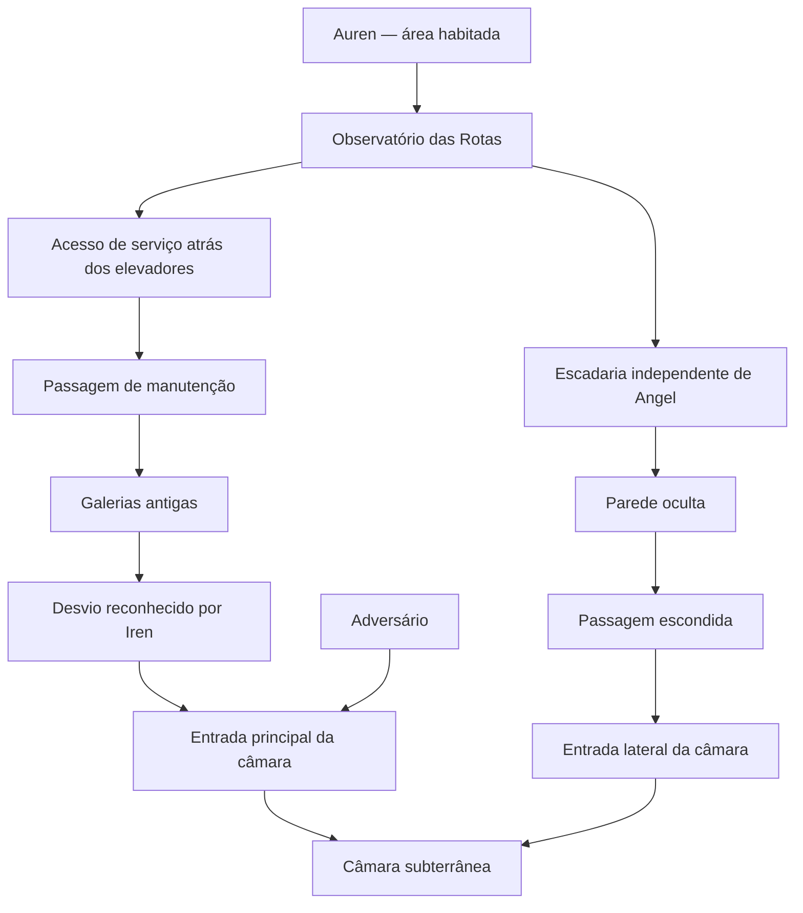

# ANGEL — topologia de rotas e controle de acessos do Episódio 01

**Data:** 13/11/2026  
**Estado:** especificação relacional para desenho de cenário; não é planta em escala nem mapa final.  
**Base:** roteiro literário atual, Storyboards 02–07, guia geográfico de Auren, layout do observatório, layout da câmara e auditoria cruzada.

## Objetivo

Fixar quais espaços se conectam e quais personagens percorrem cada rota, sem inventar distâncias, coordenadas, direções cardeais ou dimensões. A equipe de cenário deve conseguir desenhar a geografia sem misturar os percursos narrativos.

## Regra central

Até a câmara, existem **duas rotas de investigação independentes**:

1. **Rota de Nara e Iren:** observatório → acesso de serviço atrás dos elevadores de carga → passagem de manutenção → galerias antigas → desvio identificado por corrente de ar/eco → entrada principal da câmara.
2. **Rota de Angel:** saída independente do observatório → outra escadaria → parede oculta → passagem escondida → entrada lateral da câmara.

Os caminhos só convergem dentro da câmara. Não colocar Angel na galeria de manutenção, na bifurcação de Nara e Iren ou no campo de visão da dupla antes da convergência.

## Diagrama relacional

O diagrama representa relações de acesso, não distâncias nem posição geográfica. A seta do adversário indica que ele aparece pelo eixo da entrada principal; não estabelece quando ou por onde começou sua aproximação.

## Rota de Nara e Iren

- O observatório fica em nível elevado da cidade.
- Iren identifica o acesso mais plausível atrás dos elevadores de carga, com base em sua experiência nas rotas de entrega e manutenção.
- A passagem de manutenção apresenta camadas construtivas de épocas diferentes.
- A galeria conhecida termina à esquerda; o ar e o eco indicam um desvio à direita.
- Nara registra as marcas e a posição; Iren reconhece a corrente de ar e os retornos acústicos.
- A dupla chega à câmara pela entrada principal.
- O adversário aparece pelo mesmo eixo de entrada principal. Não desenhar um terceiro corredor de chegada independente nesta versão.

## Rota de Angel

- Angel segue em direção ao observatório depois do fenômeno, mas não se junta à descida de Nara e Iren.
- Ele percorre outra escadaria, fisicamente separada da galeria de manutenção.
- A parede oculta aparece no patamar dessa escadaria; sua linha só fica visível com luz lateral.
- Angel abre a passagem e entra sozinho.
- A passagem conduz à entrada lateral da câmara.
- Nara e Iren não veem a parede abrir, não atravessam essa passagem e não compartilham a escadaria.

A ligação exata entre o observatório e o início dessa escadaria ainda não está definida. O desenho deve preservar a independência sem inventar um ponto de origem definitivo.

## Topologia da câmara

A câmara tem dois acessos confirmados nesta versão:

1. **Entrada principal:** usada por Nara e Iren; também é o eixo pelo qual o adversário aparece.
2. **Entrada lateral oculta:** usada por Angel.

O centro circular, os anéis incompletos, a base central, as placas externas e a rachadura no piso são referências fixas. A placa que se desprende é uma única placa externa; o teto principal permanece estável.

Não criar:
- uma terceira entrada para o adversário;
- uma ligação visual entre a escadaria de Angel e a bifurcação da dupla;
- uma porta oculta na galeria de manutenção;
- uma passagem que faça os três personagens convergirem antes da câmara.

## Relações urbanas ainda abertas

O guia de Auren estabelece níveis e marcos, mas ainda não fixa:
- posição exata do observatório em relação à torre do sino e à praça;
- percurso métrico entre observatório e elevadores de carga;
- origem exata da escadaria independente de Angel;
- cotas de altura, largura, extensão e escala dos acessos;
- orientação cardeal ou dimensões reais da cidade.

Esses pontos devem ser definidos na planta relacional, com proporções e linhas de visão, antes de qualquer planta métrica.

## Regras para o desenho

- Primeiro desenhar a planta relacional de Auren e os níveis verticais.
- Em seguida, desenhar em folhas separadas os percursos de Nara/Iren e Angel.
- Depois, desenhar a planta superior da câmara com os dois acessos e a posição do corredor principal.
- Usar cortes verticais para mostrar a relação entre cidade, elevadores, galerias e câmara.
- Marcar posições iniciais, deslocamentos, pontos de escuta de Iren e linhas de visão de câmera.
- Não preencher lacunas com dimensões ou estruturas inventadas; registrar como pendência até decisão.

## Critério de aprovação

A topologia estará pronta para virar planta visual quando:
- os dois percursos puderem ser seguidos sem cruzamento acidental;
- a entrada principal e a lateral forem distinguíveis em qualquer plano;
- a posição do adversário não criar um terceiro acesso não aprovado;
- as linhas de visão explicarem por que Nara e Iren não veem Angel;
- a geografia permitir filmar a convergência na câmara sem teletransporte ou deslocamento invisível.

**Estado atual:** topologia textual definida. Planta desenhada, escala e dimensões continuam pendentes.
